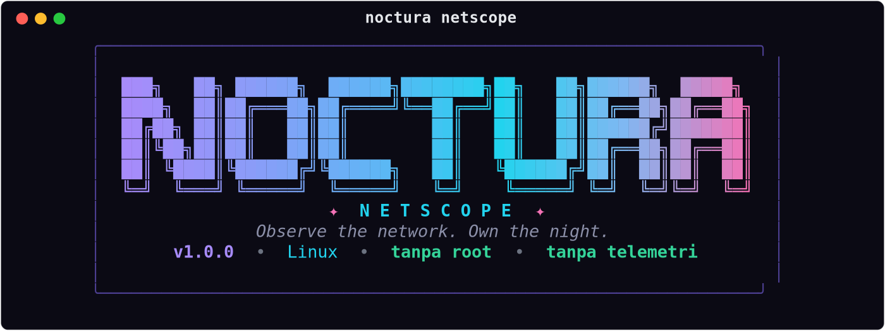
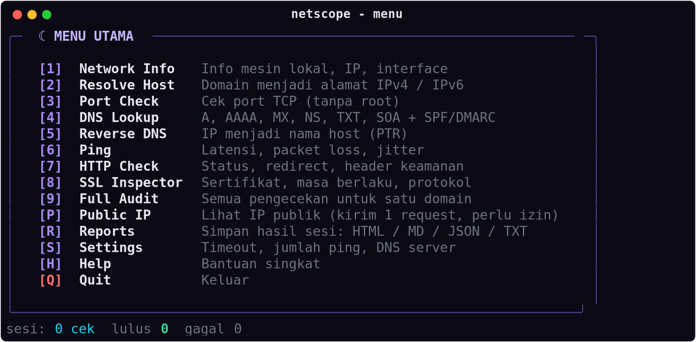
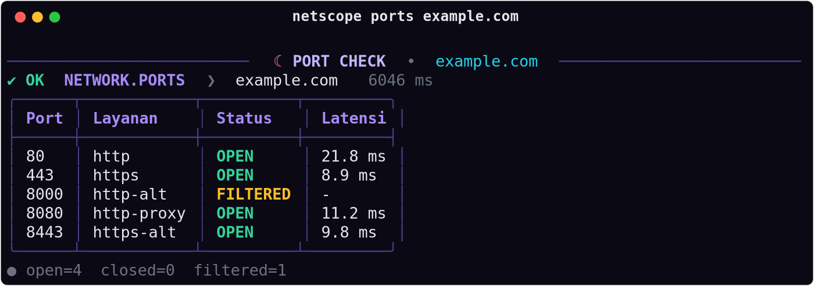
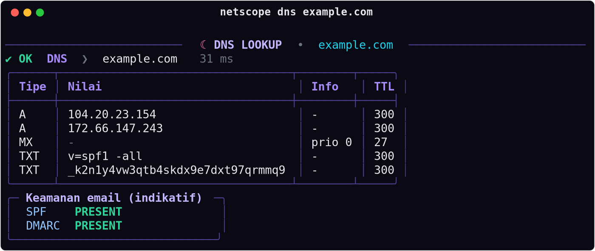
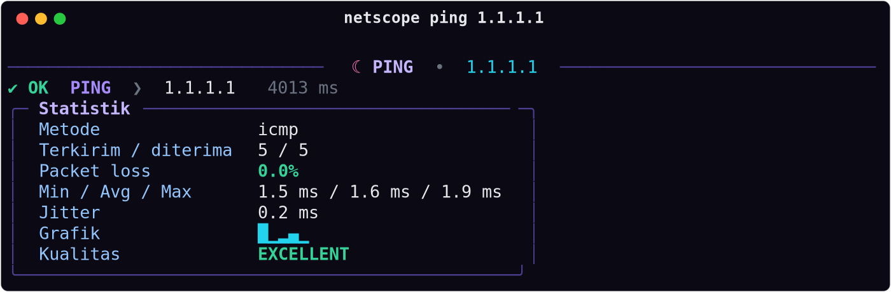
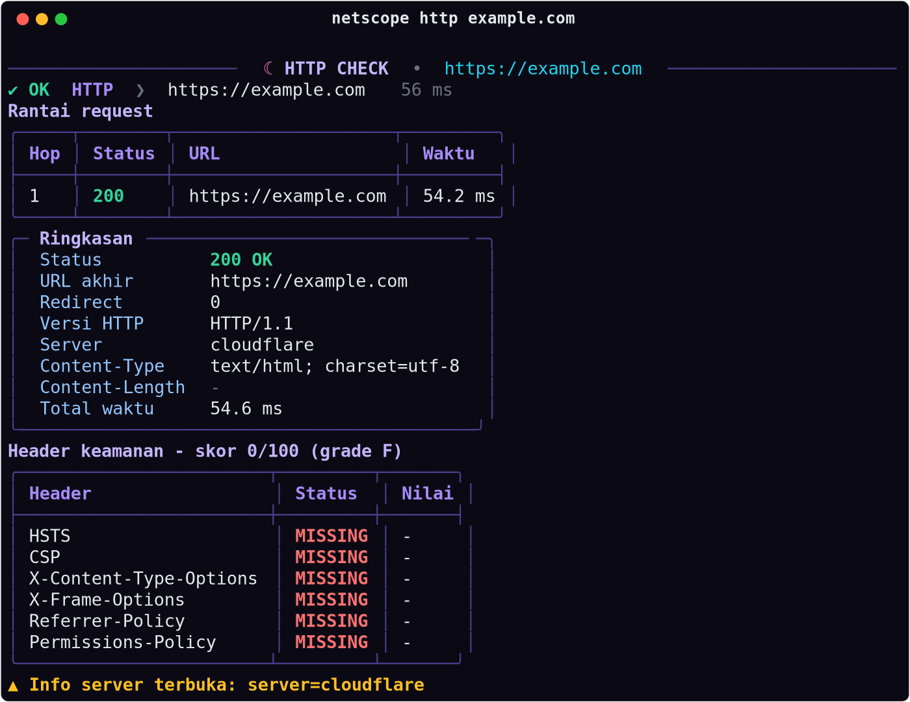
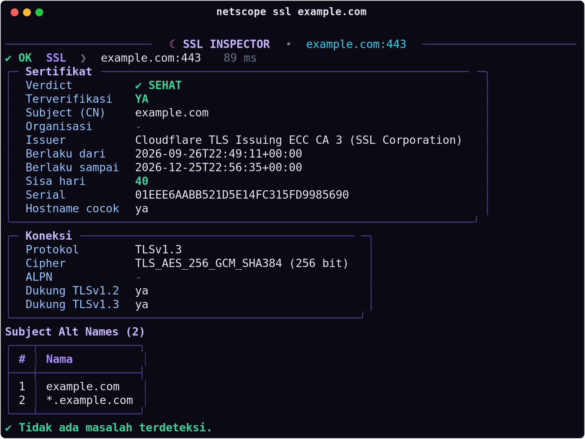

<div align="center">



<br>

# ☾ Noctura &nbsp;·&nbsp; NETSCOPE

**Observe the network. Own the night.**

Toolkit diagnostik jaringan untuk terminal — cantik, cepat, tanpa root, tanpa telemetri.

<br>


<br>

[Fitur](#-fitur) · [Instalasi](#-instalasi) · [Tutorial](#-tutorial-penggunaan) · [Laporan](#-laporan) · [Konfigurasi](#%EF%B8%8F-konfigurasi) · [Pengujian](#-pengujian) · [FAQ](#-faq--troubleshooting)

</div>

---

## ✦ Fitur

| | Modul | Kegunaan |
|---|---|---|
| 🖥️ | **Network Info** | Hostname, IP lokal (v4/v6), interface, platform |
| 🔎 | **Resolve & Port Check** | Domain → IP, cek port TCP paralel (tanpa root) |
| 🧭 | **DNS Diagnostics** | A / AAAA / CNAME / MX / NS / TXT / SOA / CAA, reverse DNS, deteksi SPF & DMARC |
| 📡 | **Ping** | ICMP bila tersedia, **otomatis fallback ke TCP ping**; loss, jitter, grafik mini, penilaian kualitas |
| 🌐 | **HTTP Checker** | Status, latensi, rantai redirect per-hop, skor & grade header keamanan |
| 🔐 | **SSL Inspector** | Sertifikat, masa berlaku, SAN, issuer, protokol TLS 1.2/1.3, cipher, deteksi self-signed / expired / hostname mismatch |
| 📝 | **Reports** | Simpan hasil ke **HTML (dark theme)**, Markdown, JSON, TXT |
| 🎛️ | **Mode ganda** | Menu interaktif **atau** CLI langsung (`--json` untuk skrip/CI) |

### 🛡️ Prinsip

- **Tanpa root** — semua fitur memakai koneksi/biner biasa.
- **Tanpa telemetri** — hanya target yang *Anda* masukkan yang dihubungi. Fitur *Public IP* adalah satu-satunya yang menghubungi pihak ketiga (`api.ipify.org`) dan **selalu meminta izin** dulu.
- **Aman terhadap input & output tak tepercaya** — data dari server (header, TXT, sertifikat) tidak pernah diinterpretasi sebagai markup terminal maupun HTML laporan.
- **Tidak crash** — setiap kegagalan jaringan menjadi pesan yang jelas, bukan stack trace.
- **Hormati `NO_COLOR`** dan otomatis memakai simbol ASCII bila terminal tidak mendukung UTF-8.

<div align="center">

</div>

---

## ⚡ Instalasi

Butuh **Python 3.8+**. Tidak butuh root.

### Termux (Android)

```bash
pkg update && pkg install -y python git
git clone https://github.com/USERNAME/NETSCOPE.git
cd NETSCOPE
bash install.sh
```

### Kali Linux / Debian / Ubuntu

```bash
sudo apt update && sudo apt install -y python3 python3-venv python3-pip git
git clone https://github.com/USERNAME/NETSCOPE.git
cd NETSCOPE
bash install.sh
```

> Ganti `USERNAME` dengan akun GitHub Anda. Bila memakai file ZIP: ekstrak, lalu `cd NETSCOPE && bash install.sh`.

Installer akan: memeriksa Python → membuat *virtualenv* terisolasi (aman untuk Kali yang menerapkan PEP 668) → memasang `rich`, `requests`, `dnspython` → membuat perintah **`netscope`** → memverifikasi.

Bila muncul peringatan `belum ada di PATH`, jalankan perintah yang ditampilkan, biasanya:

```bash
echo 'export PATH="$HOME/.local/bin:$PATH"' >> ~/.bashrc && source ~/.bashrc
```

> ⚠️ Jangan hapus atau memindahkan folder `NETSCOPE/` setelah instalasi — perintah `netscope` memakai kode di folder tersebut.

### Tanpa installer (manual)

```bash
python3 -m venv .venv && source .venv/bin/activate
pip install -r requirements.txt
python -m netscope
```

### Uninstall

```bash
bash install.sh --uninstall
```

---

## 🚀 Tutorial Penggunaan

### 1. Menu interaktif (paling mudah)

```bash
netscope
```

Ketik angka/huruf menu lalu Enter:

| Tombol | Menu | Tombol | Menu |
|:--:|---|:--:|---|
| `1` | Network Info | `8` | SSL Inspector |
| `2` | Resolve Host | `9` | **Full Audit** |
| `3` | Port Check | `P` | Public IP *(minta izin)* |
| `4` | DNS Lookup | `R` | Reports |
| `5` | Reverse DNS | `S` | Settings |
| `6` | Ping | `H` | Help |
| `7` | HTTP Check | `Q` | Quit |

- `Ctrl+C` membatalkan aksi dan kembali ke menu. `Ctrl+D` / `Q` keluar.
- Tekan **Enter** pada pertanyaan yang punya nilai `[default]` untuk memakai nilainya.

**Contoh alur: audit domain lalu simpan laporan**

```text
❯ Pilih menu: 9
❯ Domain untuk audit penuh: example.com
  ... (resolve, DNS, ping, HTTP, SSL dijalankan berurutan) ...
✔ 5 dari 5 pengecekan lulus.
❯ Simpan laporan HTML untuk audit ini? (y/N): y
```

### 2. Mode CLI (cepat & skrip-able)

```bash
netscope --help
netscope <perintah> --help
```

| Perintah | Contoh | Fungsi |
|---|---|---|
| `info` | `netscope info` | Info jaringan mesin lokal |
| `resolve` | `netscope resolve example.com` | Domain → IPv4/IPv6 |
| `ports` | `netscope ports example.com -p web` | Cek port TCP |
| `dns` | `netscope dns example.com -r A,MX,TXT` | DNS lookup |
| `reverse` | `netscope reverse 1.1.1.1` | Reverse DNS (PTR) |
| `ping` | `netscope ping 1.1.1.1 -c 5` | Ping (`-m icmp\|tcp\|auto`) |
| `http` | `netscope http example.com -X HEAD` | HTTP checker |
| `ssl` | `netscope ssl example.com:443` | Inspeksi sertifikat |
| `audit` | `netscope audit example.com` | Semua pengecekan sekaligus |
| `public-ip` | `netscope public-ip --yes` | IP publik *(butuh `--yes`)* |
| `config` | `netscope config --set timeout 15` | Lihat/ubah konfigurasi |

**Opsi umum** (berlaku untuk hampir semua perintah):

| Opsi | Fungsi |
|---|---|
| `--json` | Keluaran **JSON murni** ke stdout (tanpa banner/warna) |
| `--report FORMAT` | Simpan laporan: `html` · `md` · `json` · `txt` · `all` |
| `-t, --timeout DETIK` | Timeout jaringan (1–120) |
| `--no-color` | Matikan warna (juga otomatis bila `NO_COLOR` di-set) |
| `--no-banner` | Sembunyikan banner |

### 3. Port Check

```bash
netscope ports example.com                 # preset common (18 port umum)
netscope ports example.com -p web          # 80, 443, 8000, 8080, 8443
netscope ports example.com -p 22,80,443    # daftar
netscope ports 192.168.1.1 -p 1-1024       # rentang
```

Status: **OPEN** (terhubung) · **CLOSED** (ditolak) · **FILTERED** (timeout / tak terjangkau).
Maksimal **100 port** per pengecekan — ini alat diagnostik, bukan scanner massal.

<div align="center"></div>

> ⚖️ **Gunakan hanya pada sistem milik Anda atau yang Anda punya izin tertulis untuk mengujinya.**

### 4. DNS Lookup

```bash
netscope dns example.com                   # A, AAAA, CNAME, MX, NS, TXT, SOA
netscope dns example.com -r MX,TXT,CAA     # pilih tipe
netscope reverse 8.8.8.8
```

Ditambah indikator **SPF** dan **DMARC** (hanya membaca TXT — tidak mengirim email).
Ingin resolver tertentu? `netscope config --set dns_server 1.1.1.1`.

<div align="center"></div>

### 5. Ping

```bash
netscope ping 1.1.1.1 -c 5
netscope ping example.com -m tcp           # paksa TCP ping
netscope ping example.com:8080 -m tcp      # TCP ping ke port tertentu
```

- `auto` (default): coba ICMP → bila biner `ping` tidak ada / ICMP tidak diizinkan (umum di sebagian lingkungan Android), **otomatis beralih ke TCP ping** dan memberi catatan.
- Port TCP yang *tertutup* tetap dihitung sebagai balasan (RST membuktikan host hidup).
- Kualitas: `EXCELLENT` · `GOOD` · `FAIR` · `POOR` · `DOWN` berdasarkan rata-rata, loss, dan jitter.

<div align="center"></div>

### 6. HTTP Checker

```bash
netscope http example.com
netscope http https://example.com/login -X HEAD
netscope http https://self-signed.local -k      # -k = jangan verifikasi TLS
```

Menampilkan rantai redirect (maks 10 hop, deteksi loop), waktu per hop, dan **audit header keamanan** (HSTS, CSP, X-Content-Type-Options, X-Frame-Options, Referrer-Policy, Permissions-Policy) dengan skor 0–100 dan grade **A–F**. Body respons tidak diunduh.

<div align="center"></div>

### 7. SSL Inspector

```bash
netscope ssl example.com
netscope ssl mail.example.com:993
```

Verdict **SEHAT / PERLU PERHATIAN**, plus masa berlaku (peringatan `< 30 hari`), issuer, SAN, protokol & cipher yang dinegosiasikan, dukungan TLS 1.2/1.3. Bila verifikasi gagal, sertifikat tetap dibaca (tanpa mengirim data) supaya **penyebabnya** terlihat: expired, self-signed, rantai tidak lengkap, atau hostname tidak cocok.

<div align="center"></div>

### 8. Full Audit

```bash
netscope audit example.com --report html
```

Menjalankan *resolve → DNS → ping → HTTP → SSL*. Satu langkah gagal **tidak** menghentikan yang lain. Untuk target berupa IP, langkah DNS dilewati.

### 9. Otomasi & CI (`--json`)

```bash
# stdout = JSON murni, aman dipipa
netscope ssl example.com --json | jq '.data.certificate.days_left'

# gunakan exit code
netscope http https://example.com --json >/dev/null && echo "UP" || echo "DOWN"
```

| Exit code | Arti |
|:--:|---|
| `0` | Semua pengecekan lulus |
| `1` | Ada pengecekan yang gagal |
| `2` | Salah penggunaan (argumen/nilai tidak valid) |
| `130` | Dibatalkan pengguna (Ctrl+C) |

---

## 📝 Laporan

```bash
netscope audit example.com --report all     # html + md + json + txt
```

Laporan disimpan di folder **`reports/`** (atau `~/netscope-reports` bila folder proyek tidak bisa ditulis). File tidak pernah menimpa yang lama (`-1`, `-2`, …) dan **tidak pernah dikirim ke mana pun**.

| Format | Cocok untuk |
|---|---|
| `html` | Dibagikan/dicetak — satu file, tema gelap, tanpa dependensi |
| `md` | Ditempel ke issue / dokumentasi |
| `json` | Diolah program lain |
| `txt` | Dibaca cepat / log |

> Isi laporan bisa memuat nama domain & detail teknis target Anda. Folder `reports/` sudah masuk `.gitignore` agar tidak ter-commit tak sengaja.

---

## ⚙️ Konfigurasi

File: `~/.config/netscope/config.json` (atau lokasi dari `$NETSCOPE_CONFIG`).

```bash
netscope config                              # lihat
netscope config --set timeout 15             # ubah & simpan
```

| Kunci | Default | Keterangan |
|---|---|---|
| `timeout` | `8.0` | Timeout jaringan (detik, 1–120) |
| `ping_count` | `4` | Jumlah paket ping (1–50) |
| `dns_server` | `""` | IP resolver kustom; kosong = resolver sistem |
| `report_dir` | `""` | Folder laporan; kosong = otomatis |
| `user_agent` | `Noctura-NETSCOPE/x.y.z` | User-Agent untuk HTTP & IP publik |

Override cepat lewat environment: `NETSCOPE_TIMEOUT=20 netscope http example.com`.

File konfigurasi yang rusak atau bernilai salah **tidak membuat program crash** — nilai bermasalah diganti default dan sebuah peringatan ditampilkan.

---

## 🧪 Pengujian

Setiap modul punya tes sendiri. Seluruh tes berjalan **offline** (server HTTP/TLS/TCP lokal di `127.0.0.1`, resolver DNS tiruan) sehingga stabil dan tidak menyentuh konfigurasi asli Anda.

```bash
pip install -r requirements-dev.txt
python -m pytest
```

| Berkas tes | Cakupan |
|---|---|
| `test_utils_config.py` | Validasi host/URL/port, konfigurasi, file rusak |
| `test_network.py` | Info lokal, resolve, port open/closed/filtered, IP publik |
| `test_dns.py` | Semua tipe record, NXDOMAIN, timeout, SPF/DMARC, reverse |
| `test_ping.py` | Parser Linux/Windows/macOS, statistik, fallback TCP |
| `test_http.py` | Redirect, loop, error status, audit header, keamanan markup |
| `test_ssl_check.py` | Self-signed, expired, hostname mismatch, wildcard |
| `test_reports.py` | 4 format, escape XSS, anti-timpa, error tulis |
| `test_core_cli.py` | CLI, exit code, JSON murni, persetujuan IP publik, menu, banner |

> Tes TLS membutuhkan paket `cryptography` (ada di `requirements-dev.txt`); bila tidak terpasang, tes tersebut dilewati otomatis.

---

## 🗂️ Struktur Proyek

```text
NETSCOPE/
├── netscope/
│   ├── __init__.py        versi & identitas
│   ├── __main__.py        python -m netscope
│   ├── main.py            CLI (argparse, exit code, --json)
│   ├── menu.py            menu interaktif
│   ├── banner.py          logo gradien + fallback ASCII
│   ├── core.py            Session: orkestrasi + riwayat sesi
│   ├── config.py          konfigurasi tervalidasi
│   ├── ui.py              tema & komponen Rich (aman-markup)
│   ├── utils.py           validasi target, hasil standar, platform
│   └── modules/
│       ├── network.py     info lokal, resolve, port, IP publik
│       ├── dns.py         DNS diagnostics
│       ├── ping.py        ICMP + TCP ping
│       ├── http.py        HTTP checker
│       ├── ssl_check.py   SSL/TLS inspector
│       └── reports.py     HTML / MD / JSON / TXT
├── tests/                 pytest, per modul
├── reports/               keluaran laporan (diabaikan git)
├── assets/                gambar README
├── install.sh
├── requirements.txt
├── requirements-dev.txt
├── pyproject.toml
├── LICENSE
└── README.md
```

---

## ❓ FAQ & Troubleshooting

<details>
<summary><b>Ping gagal / "ICMP tidak diizinkan"</b></summary>

Di Termux dan beberapa lingkungan terbatas, ICMP diblokir. Pada mode `auto` NETSCOPE otomatis memakai **TCP ping**. Anda juga bisa memaksanya: `netscope ping host -m tcp`.
</details>

<details>
<summary><b>Kali: <code>externally-managed-environment</code></b></summary>

Itu aturan PEP 668 untuk `pip` global. `install.sh` sudah memakai virtualenv sehingga aman. Pastikan `python3-venv` terpasang: `sudo apt install -y python3-venv`.
</details>

<details>
<summary><b>Tampilan berantakan / muncul kotak □</b></summary>

Font terminal tidak mendukung karakter box-drawing. Gunakan font monospace modern (mis. JetBrains Mono, Fira Code, DejaVu Sans Mono; di Termux pasang **Termux:Styling**). NETSCOPE otomatis memakai simbol ASCII bila encoding bukan UTF-8; paksa dengan `LANG=C.UTF-8` atau matikan warna dengan `--no-color`.
</details>

<details>
<summary><b><code>netscope: command not found</code></b></summary>

Folder `~/.local/bin` belum ada di `PATH`. Jalankan: `echo 'export PATH="$HOME/.local/bin:$PATH"' >> ~/.bashrc && source ~/.bashrc`. Alternatif tanpa PATH: `python -m netscope` dari folder proyek.
</details>

<details>
<summary><b>Port tampil FILTERED padahal layanan hidup</b></summary>

Artinya koneksi *timeout* atau jaringan tidak terjangkau — biasanya firewall yang men-drop paket. Naikkan batas waktu: `netscope ports host -t 10`.
</details>

<details>
<summary><b>Apakah ada data yang dikirim ke pihak ketiga?</b></summary>

Tidak, kecuali Anda sendiri memilih **Public IP** (`api.ipify.org`) dan menyetujui. Tidak ada telemetri, analitik, atau pelaporan otomatis.
</details>

---

## 🧭 Catatan Kompatibilitas

Dikembangkan dan diuji otomatis pada **Linux (Debian) dengan Python 3.13**. Kode ditulis kompatibel Python 3.8+ dan memakai jalur khusus untuk **Termux**, **Kali Linux**, **macOS**, dan **Windows** (flag `ping` per-OS, deteksi platform, fallback TCP), namun pengujian langsung pada perangkat Termux/Kali fisik belum dilakukan oleh pengembang awal. Bila menemukan masalah di platform tertentu, silakan buka *issue* dengan menyertakan keluaran `netscope info`.

## 🤝 Kontribusi

1. *Fork* → buat branch (`git checkout -b fitur-baru`)
2. Tambahkan/ubah kode **beserta tesnya**
3. Pastikan `python -m pytest` hijau
4. Buka *Pull Request*

## 📜 Lisensi

[MIT](LICENSE) © Noctura NETSCOPE contributors

<div align="center">

<sub>☾ Stay curious. Stay safe. Test only what you own. ☾</sub>

</div>
